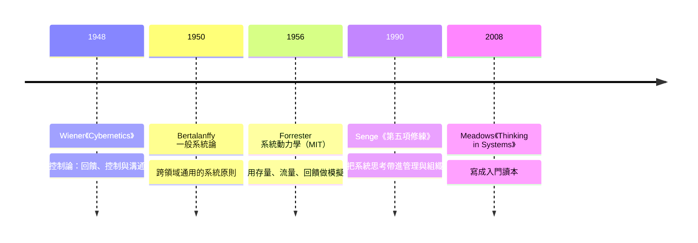

# 第 1 集｜系統思考不是新潮詞：它已經快 80 歲了

▶ [看影片](https://youtube.com/shorts/S9PeAKxAuM0)　｜　[回到索引](../README.md)

## 核心觀念

系統思考不是最近才冒出來的流行詞，它的源頭可以追到 1940–50 年代。它是為了解決一種問題而生的：**問題的原因，常常不在外面，而在自己的結構裡。** 知道它為了解決什麼問題，才知道什麼時候該用它。

## 重點整理

- **系統思考是什麼**：看整體、關係與回饋，而不是只看單一事件。
- **回饋（feedback）**：一件事的結果，會回頭影響原因。例如：室溫太低 → 暖氣開啟 → 室溫上升 → 暖氣關閉。
- **GE 的謎題**：1950 年代中期，美國奇異（GE）在肯塔基的家電廠，一陣子要開到三班，幾年後又得裁掉一半員工。大家都說「是景氣循環」，但這個解釋不夠有說服力。
- **Forrester 的發現**：他只用紙和筆，在一頁筆記本上算：庫存、員工、訂單，依公司實際的僱用和庫存規則一週一週推下去。結果發現，**就算外面的訂單完全不變，公司自己的決策規則也會造成就業忽高忽低。** 問題出在結構，不是景氣。這成了「系統動力學」的起點。
- **時間軸（影片最後一幕）**：

## 引文

> "Leverage points are not intuitive. Or if they are, we intuitively use them backward…"
> — Donella Meadows，〈Leverage Points: Places to Intervene in a System〉，Sustainability Institute，1999

**意譯**：槓桿點常常違反直覺；就算憑直覺找到了，也常常推錯方向。（第 11 集會回頭講這一點。）

> "…puzzled by why their household appliance plants in Kentucky were sometimes working three and four shifts and then a few years later, half the people would be laid off."
> "…Even with constant incoming orders, one could get employment instability as a consequence of commonly used decision-making policies."
> — Jay W. Forrester，"The Beginning of System Dynamics"，System Dynamics Society 晚宴演講，Stuttgart，1989-07-13（MIT D-4165-1）

**意譯**：（GE 的人）搞不懂為什麼他們在肯塔基的家電廠，有時要開三、四個班，幾年後又得裁掉一半的人。……就算進來的訂單固定不變，常見的決策規則也會造成就業不穩。

## 推導與備註

- **推導**：「問題的原因常常在自己的結構裡」是我們對這個故事的總結，不是 Forrester 的原話。
- **備註（影片的簡化）**：影片寫「每 3 年起伏一次」。Forrester 1989 年演講的原話是「幾年後」（"a few years later"），他 1992 年的自傳章節寫「兩三年後」。「每 3 年一輪」是影片的簡化說法，不是原文。
- **備註（來源說明）**：影片當時的出處標示用了維基百科（見下方「影片當時引用」）。這份筆記另外用一手來源重新核對，GE 的故事以 Forrester 本人的敘述為準；上面兩段 Forrester 引文已對照 MIT D-4165-1 的 PDF 全文逐字核對（"were sometimes working three and four shifts…" 在該文第 6 頁）。
- 1948 與 1950 兩個年份是書目資訊（Wiener《Cybernetics》1948；Bertalanffy "An Outline for General Systems Theory" 1950），本次沒有打開原書原文；「控制論」一詞取自希臘文「舵手」的說法，同樣未對照原書。

## 來源

- Jay W. Forrester, "The Beginning of System Dynamics," 1989（✅ 已開 PDF 核對；見 [references.md](../references.md)）
- Donella H. Meadows, "Leverage Points: Places to Intervene in a System," 1999
- Norbert Wiener, *Cybernetics*, 1948（⚠️ 書目資訊）
- Ludwig von Bertalanffy, "An Outline for General Systems Theory," 1950（⚠️ 書目資訊）
- Peter Senge, *The Fifth Discipline*, 1990（⚠️ 書目資訊）
- Donella H. Meadows, *Thinking in Systems*, 2008

## 影片當時引用

已發布的第 1 集影片與說明欄，實際標示的來源如下（維持原樣列出，以便對照）：

- Wikipedia：System dynamics https://en.wikipedia.org/wiki/System_dynamics
- Wikipedia：Cybernetics https://en.wikipedia.org/wiki/Cybernetics
- Wikipedia：Systems theory https://en.wikipedia.org/wiki/Systems_theory
- Wikipedia：Peter Senge https://en.wikipedia.org/wiki/Peter_Senge
- Donella Meadows〈Leverage Points: Places to Intervene in a System〉 https://donellameadows.org/archives/leverage-points-places-to-intervene-in-a-system/
- The Donella Meadows Project：Systems Thinking Resources https://donellameadows.org/systems-thinking-resources/

維基百科是百科全書，不是一手來源；上面的一手來源是我們後來補上的核對。

**背景音樂**：Doodles ( LoFi , Happy ) by HoliznaCC0，CC0 1.0 公眾領域貢獻
https://freemusicarchive.org/music/holiznacc0/public-domain-lofi/doodles-lofi-happy-mp3/
