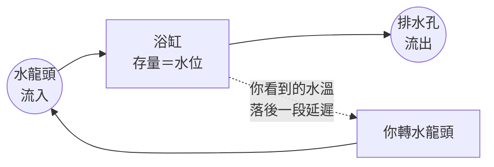

# 第 3 集｜為什麼淋浴水溫一下燙一下冰？搞懂「延遲」就懂了

▶ [看影片](https://youtube.com/shorts/uBsksbpaosg)　｜　[回到索引](../README.md)

## 核心觀念

調整總是過頭，多半是因為**回饋有延遲**：你現在看到的，是舊的狀態；你做的調整，要過一陣子才生效。再加上很多東西像浴缸一樣，有慣性、不會馬上變，人就容易一直補、一直補，最後補過頭。

## 重點整理

- **存量（stock）**：累積下來的量，像浴缸裡的水位、倉庫的庫存、銀行存款。
- **流量（flow）**：進出存量的速度，像水龍頭（進）和排水孔（出）。
- **存量有慣性**：存量要靠流量慢慢改變，所以不會一下子變。人常低估這個慣性。
- **延遲（delay）**：行動和結果之間隔了一段時間。淋浴的水從混水閥到蓮蓬頭要走一段管線，你轉了水龍頭，一分鐘後才感覺到，所以你一直轉、一直過頭。
- **供應鏈 ＝ 一排浴缸**：每一關的庫存是一個浴缸，關與關之間有「下單」和「運送」兩段延遲。
- **MIT 啤酒遊戲（Sterman 1989 的實驗）**：
  - 四個人：零售、批發、經銷、工廠，各自管自己的庫存和訂單；只有零售商看得到顧客的需求。
  - 顧客需求只在第 5 週增加一次：每週 4 箱 → 8 箱。
  - 各關平均訂單峰值：顧客 8、零售商 15、批發商 19、經銷商 27、工廠 32。工廠的峰值是顧客峰值的 4 倍。
  - 玩家平均只把「已下單、還沒到」的量算進 34%（最佳值是 100%）。

- **帶走三問**：這是存量還是流量？回饋要等多久？有什麼在途、還沒生效？

## 引文

> "People often underestimate the inherent momentum of a stock."
> — Donella Meadows，*Thinking in Systems: A Primer*，Chelsea Green，2008，Ch.1 "Bathtubs 101"

**意譯**：人們常低估存量本身的慣性。

> "A delay in a balancing feedback loop makes a system likely to oscillate."
> — 同上，Ch.2 "A Brief Visit to the Systems Zoo"（約 pp.53–56；頁碼為約略）

**意譯**：調節環路裡有延遲，系統就很可能來回擺盪。

> "The delays inherent in the action of these negative loops tend to allow population and capital to overshoot their ultimately sustainable levels."
> — Meadows 等，*The Limits to Growth*，Universe Books，1972，p.156（頁碼依掃描檔頁首推斷；影片畫面為縮短版）

**意譯**：這些負回饋環路的作用本身有延遲，容易讓人口與資本衝過最終能維持的水準。

> "…you only receive delayed information about what the system state is, you will overshoot and undershoot…"
> — Donella Meadows，〈Leverage Points〉，1999，槓桿點 #9（延遲）

**意譯**：（因為）你收到的是關於系統狀態的、延遲的資訊，就會調過頭、又調不足。（以上為片段引用；Meadows 在同一節也提到她在倫敦旅館淋浴，水溫至少一分鐘才回應。）

## 推導與備註

- 「浴缸＋延遲＝淋浴調過頭」是我們用 Meadows 的說法整理的白話串連；Meadows 在書中提到淋浴混水閥到蓮蓬頭的管線過長會造成忽冷忽熱，是她自己的例子。
- 「工廠峰值是顧客峰值的 4 倍」＝32 ÷ 8。Sterman 論文用相對原需求 4 箱的「700%」放大倍率表示，兩者不衝突，影片採前者，比較直觀。
- Sterman 的 44 人樣本是論文篩選後（排除記錄有誤的組別）的結果，論文自己說會偏向表現較好的受試者。
- 啤酒遊戲規則：補貨延遲至少 4 週（工廠 3 週），目標是總成本最低（Sterman 1989 §3）。
- 《成長的極限》的結論與模型曾受經濟學者批評；本集只引用它對「存量慣性與延遲造成超調」的陳述，不轉述它的預測。
- Meadows 的背景（影片場景 2）：《Thinking in Systems》作者簡介說她與 Forrester 在 MIT 共事、是 World3 團隊成員；她 1991 年的手稿記述 1970 年羅馬俱樂部在伯恩開會、Forrester 表示他的方法能整合全球問題。我們不寫入她加入 MIT 的年份，因為不同資料說法不同。

## 來源

- Donella H. Meadows, *Thinking in Systems: A Primer*, 2008（Author's Note、Ch.1、Ch.2）
- Meadows et al., *The Limits to Growth*, 1972（Introduction p.31、p.37、p.156）
- Donella H. Meadows, "How The Limits to Growth Happened," 1991 手稿節選
- Donella H. Meadows, "Leverage Points," 1999
- John D. Sterman, "Modeling Managerial Behavior…," *Management Science* 35(3), 1989, pp. 321–339（§3 實驗設計、Table 2、Table 3）

（完整資訊見 [references.md](../references.md)）
