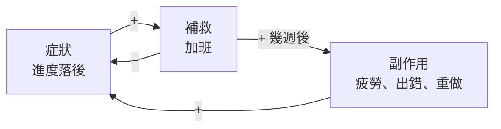

# 第 4 集｜為什麼加班越多，事情反而越多？飲鴆止渴

▶ [看影片](https://youtube.com/shorts/0jIuBsSUWPI)　｜　[回到索引](../README.md)

## 核心觀念

有一種結構叫 **Fixes That Fail**（本系列稱「飲鴆止渴」）：你為了解決症狀，做了一個有效的補救；但補救會產生副作用，**副作用晚一步才出現**，結果症狀又回來，你只好再補救一次，越補越多。

> 「飲鴆止渴」是我們選用的中文名稱，不是官方譯名。

## 重點整理

- **基模（archetype）從哪來**：1960–70 年代，Forrester、Meadows 等人觀察到系統裡反覆出現的結構；1990 年 Senge《第五項修練》把它們帶給管理者；1998 年 Kim & Anderson 整理成工作手冊，Fixes That Fail 是其中第一個。
- **兩個環路接在一起**（影片的情節是**假設例**）：
  - 第一個環路（**平衡環路 B1**）：症狀（進度落後）→ 補救（加班）→ 症狀暫時減輕。**這個有用，所以人會一直用。**
  - 看不見的第二個環路（**增強環路 R2**）：補救 → 副作用（疲勞累積、出錯、重做；要幾週後才出現）→ 工作量增加 → 又落後 → 再加班。
- **為什麼越補越糟**：補救循環得越快，副作用的環路就越常被啟動。
- **有數據嗎**：Pencavel 用一戰英國軍火工人的資料發現，每週工時低於 49 小時，產出和工時成正比；超過 49 小時，多出來的工時換到的產出越來越少；約 63 小時產出達到最高。
- **怎麼拆**（原書建議的步驟）：
  1. 列出過去和現在用過的「補救」（加班、外包、延期）
  2. 描繪每個補救的非預期後果（幾週後才出現什麼？）
  3. 找出造成症狀的根本原因（需求太多？工時估得太樂觀？括號為我們的例子）

（B1：症狀 → 補救 → 症狀減輕。R2：補救 → 副作用 → 症狀回來。圖為我們對書中結構的簡化。）

- **帶走兩問**：真正的根本問題是什麼？這個補救有什麼副作用、多久之後才出現？

## 引文

> "The faster the quick-fix loop cycles, the more often the unintended-consequence loop is activated."
> — Daniel H. Kim & Virginia Anderson，*Systems Archetype Basics*，Pegasus，1998，Section 2 "Fixes That Fail"（IN SUMMARY 段）

**意譯**：快速補救的環路轉得越快，非預期後果的環路就越常被啟動。

> "What is the fundamental problem here?" / "What are the unintended side-effects of my actions?"
> — 同上，Fixes That Fail 一章

**意譯**：這裡真正的根本問題是什麼？我的行動有什麼非預期的副作用？

> "How could the solution we want to implement possibly come around and worsen the problem?"
> — 同上，Fixes That Fail 一章，"Managing"，p.13–15（第 11 集再次引用）

**意譯**：我們想實施的解法，有可能怎麼繞回來、反而讓問題更糟？

## 推導與備註

- **影片的加班情節（連續加班 → 疲勞 → 出錯 → 返工 → 工作量增加）是假設例。上述來源並沒有實證「疲勞造成返工」這條因果。**
- Pencavel 證明的是「工時拉長、邊際產出遞減」，樣本是 1910 年代的軍火工廠，不能直接套到今天的辦公室知識工作，只作參考。
- 影片中的環路寫法與本筆記的圖，是我們對書中結構的簡化。
- 影片與說明欄中「迴路」一詞，本 repo 統一寫「環路」。
- 延伸閱讀（影片沒用）：Repenning & Sterman 2002，談改善投入與回報之間的延遲（我們只讀了摘要）。

## 來源

- Daniel H. Kim & Virginia Anderson, *Systems Archetype Basics*, 1998（To the Reader；Section 2）
- Peter Senge, *The Fifth Discipline*, 1990（⚠️ 僅背景）
- John Pencavel, "The Productivity of Working Hours," *The Economic Journal* 125(589), 2015

（完整資訊見 [references.md](../references.md)）
