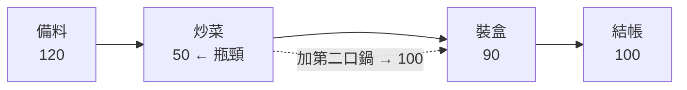

# 第 5 集｜多請一個人，為什麼出餐還是一樣慢？找出最慢的那一環

▶ [看影片](https://youtube.com/shorts/zKuYBcUUM1E)　｜　[回到索引](../README.md)

## 核心觀念

一條流程的速度，**取決於最慢的那一站**。改善最慢站以外的地方，整體不會變快。這就是限制理論（Theory of Constraints, TOC）的出發點。

## 重點整理

- **它從哪裡來**（經 Rahman 1998 整理）：Goldratt 在 1980 年發展 OPT 生產排程系統；1984 年與 Cox 以小說《The Goal》，用工廠現場的故事講解概念；1987 年起統稱為限制理論。
- **限制（constraint）**：任何讓系統達不到更好表現的東西。可以是實體的（物料、機器、人、需求量），也可以是管理面的（政策、規則）。
- **假設例：便當店四站出餐線**（數字全是假設）：

| 站 | 每小時產能 |
|---|---|
| 備料 | 120 份 |
| 炒菜 | **50 份**（最慢） |
| 裝盒 | 90 份 |
| 結帳 | 100 份 |

  整條線每小時只出 50 份；多請 1 個人備料，還是 50 份。非限制資源多做，只會增加庫存，不會增加產出。
- **五個聚焦步驟**（Goldratt，經 Rahman 整理；括號為便當店例子）：
  1. 找出限制（炒菜站，50 份）
  2. 榨乾限制（炒鍋不空轉、不等料）
  3. 其他站配合它（備料只備 50 份的量）
  4. 提升限制（加第二口炒鍋：50 → 100 份）
  5. 回到第 1 步（新限制移到裝盒，90 份；整條線從 50 升到 90）
- **限制會移動**：提升一個限制後，瓶頸會移到下一站。

- **黃仁勳也在問同一件事**：「瓶頸是處理器、記憶體，還是網路？」
- **帶走三問**：每一站的速度各是多少？最慢的是哪一站？改完後新的最慢站在哪？

## 引文

> "…anything that limits a system from achieving higher performance versus its goal."
> — Eliyahu Goldratt，1988，p.453，**轉引自** Shams-ur Rahman, *IJOPM* 18(4), 1998

**意譯**：任何讓系統達不到更好表現（相對於它的目標）的東西。

> "…what are the constraints?… Is it processor? Is it memory? Is it networking?"
> — 黃仁勳，Y Combinator Startup School 2026，20:44–21:25（YouTube 自動字幕，去口吃）

**意譯**：限制是什麼？是處理器、是記憶體，還是網路？

## 推導與備註

- **便當店四站的所有數字都是假設例**，用來說明概念；數字能自洽（加第二口鍋後炒菜 100 份，新限制變成裝盒 90 份）。
- Goldratt 的定義與五步驟，我們**沒有讀過 Goldratt 原文**，只經 Rahman 1998 轉引，所以標示「經 Rahman 整理」。《The Goal》同樣只透過 Rahman 介紹。
- 把黃仁勳的話和限制理論放在一起，是我們的對照，不是他說他在用 TOC。

## 來源

- Shams-ur Rahman, "Theory of constraints: A review of the philosophy and its applications," *International Journal of Operations & Production Management* 18(4), 1998, pp. 336–355
- Eliyahu Goldratt & Jeff Cox, *The Goal*, 1984（⚠️ 轉引）
- Y Combinator, Jensen Huang, Startup School 2026（見 [references.md](../references.md)）
