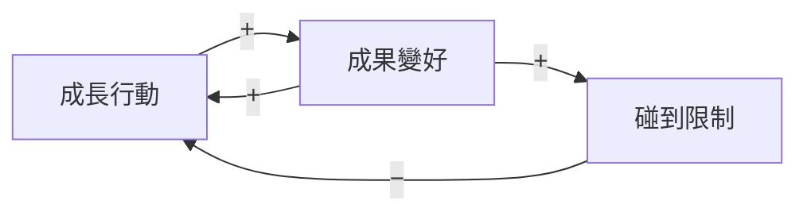

# 第 7 集｜AI 越長越大，會先卡在哪裡？成長上限與投資不足

▶ [看影片](https://youtube.com/shorts/lpK_SUJcv_I)　｜　[回到索引](../README.md)

## 核心觀念

任何成長，都是**增強環路在推**；但成長會碰到限制，限制一到，調節環路就啟動，成長減緩甚至停止。如果能在碰到限制之前，就先處理它，限制可以被消除或延後。

## 重點整理

- **兩個基模**：
  - **成長上限（Limits to Success／Limits to Growth）**：增強環路推動成長 → 成長碰到限制 → 調節環路啟動 → 成長減緩。
  - **成長與投資不足（Growth and Underinvestment）**：成長接近限制，卻沒有及早投資產能，成長反而被自己卡住。
- **從哪裡來**：1990 年 Senge《第五項修練》把「成長上限」列為九個基模之一；1998 年 Kim & Anderson 收錄為 Limits to Success，並另列「成長與投資不足」。
- **AI 的限制可能是什麼**（黃仁勳的說法）：
  - 資料：曾被認為，高品質資料的量會限制 AI 能到的智慧。
  - 電力：他舉了一個情境，如果每週造出 50 吉瓦的運算設備，供應鏈每週就需要 1 吉瓦的電力。（50 吉瓦是他舉的情境，不是預測。）
- **他怎麼處理**：先向供應鏈夥伴解釋原因，再請他們各投資數十億美元。

（上方增強環路推動成長，下方調節環路在限制出現時把成長拉下來。圖為我們的簡化。）

- **帶走三問**：現在靠哪個增強環路在成長？下一個限制是什麼（資料、電力，還是供應鏈）？產能要先投資，還是等需求掉了才補？

## 引文

> "…growth approaches a limit that could be eliminated or postponed if capacity investments were made."
> — Daniel Kim & Virginia Anderson，*Systems Archetype Basics*，1998，Section 6，p.73

**意譯**：成長接近一個限制，而這個限制，只要有做產能投資，就能被消除或延後。

以下為黃仁勳，Lex Fridman Podcast #494（官方人工逐字稿）：

> "…the amount of data that we have, high-quality data that we have, will limit the intelligence that we achieve."
> — 約 00:23:12

**意譯**：我們擁有的資料量、高品質資料的量，會限制我們能達到的智慧。

> "…each week in the supply chain, the supercomputers are gonna need a gigawatt of power."
> — 約 00:44:42（前提為他舉的情境：每週造出 50 吉瓦）

**意譯**：（在那個情境下）供應鏈裡每週造出的超級電腦，就需要 1 吉瓦的電力。

> "…I first explain to them what's going on, why it's gonna happen, and then I ask 'em to make several billion dollars of capital investments each."
> — 約 00:46:05

**意譯**：我先向他們解釋發生了什麼、為什麼會發生，然後請他們各自做數十億美元的資本投資。

## 推導與備註

- **推導**：「他先投資產能，是在避開投資不足」是本頻道的對照，不是黃仁勳或原書的說法。
- 三層結構圖的環路寫法，參考 Senge〈思考的魔術〉（天下雜誌 1994）對成長上限的說明，已大幅精簡、意譯。
- 本頻道與 NVIDIA 無關聯。

## 來源

- Daniel Kim & Virginia Anderson, *Systems Archetype Basics*, 1998（Contents；Section 6）
- Peter Senge, *The Fifth Discipline*, 1990（⚠️ 僅背景）；Senge〈思考的魔術〉，天下雜誌，1994（⚠️ 僅用中文譯名與概念）
- Lex Fridman Podcast #494, Jensen Huang，官方逐字稿，2026

（完整資訊見 [references.md](../references.md)）
