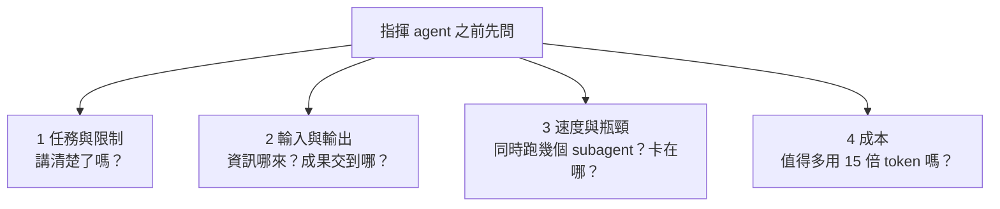

# 第 8 集｜指揮一群 AI，為什麼要懂系統思考？

▶ [看影片](https://youtube.com/shorts/xkBCSg3hPzo)　｜　[回到索引](../README.md)

## 核心觀念

這集分兩半。前半：黃仁勳說，多數底層工作都會由 agent 代勞，所以人要更會抽象地想系統。後半：multi-agent 是什麼，以及它的好處和代價。把兩半接起來：**指揮一群 agent，本質上是在設計一個系統**，要問的問題和系統思考一樣。

## 重點整理

- **名詞**
  - **AI agent**：會自己用工具完成任務的 AI。
  - **multi-agent**：一群 agent 分工合作；一個 agent 單獨做，叫 single-agent。
  - **lead agent**：拆解問題、分派工作的那一個。
  - **subagent**：同時各自負責一部分的 agent。
  - **token**：AI 計算文字量的單位，用得越多越貴。
- **黃仁勳怎麼說**：
  - 底層工作交給 agent；NVIDIA 多數設計師其實是系統設計師。
  - 他會問：要解決什麼問題、有哪些限制、輸入輸出在哪、資訊從哪來、進出速度多快、瓶頸在處理器、記憶體還是網路（同第 2 集）。
  - 談到 agent 系統，他同樣從基本問題出發：工作負載是什麼、瓶頸在哪、怎麼擴展、同時執行（concurrency）會怎樣。
  - 他的結論：越會系統思考，越能指揮數百萬個自主解題的 agent。
- **Anthropic 的 multi-agent 研究系統**（2025 年 6 月公開）：lead agent 拆解問題，subagent 同時各自負責一部分。
  - **成效**：在 Anthropic 內部的研究評測上，表現優於 single-agent 90.2%。
  - **代價**：token 用量約是一般聊天的 15 倍。
  - 90.2% 是**他們自己的內部評測**，不是通用基準，且僅限其研究任務。
- **帶走四問**（我們把黃仁勳的問題套到 multi-agent）：

## 引文（黃仁勳；YC Startup School 2026；YouTube 自動字幕，去口吃）

> "…most of the low-level things… are going to be done agentically anyways… most of our designers are systems designers."
> — 20:14–20:37

**意譯**：大部分低階的事都會交給 agent 去做……我們多數設計師其實是系統設計師。

> "…what is the workload… where are the bottlenecks… how it scale… what happens to concurrency?"
> — 24:43

**意譯**：工作負載是什麼？瓶頸在哪？怎麼擴展？同時執行會發生什麼？

> "…the better you are at systems thinking so that you could orchestrate millions of agents solving problems autonomously, the better off you are."
> — 43:23（約至 43:31）

**意譯**：你越擅長系統思考，就越能指揮數百萬個自主解題的 agent，你就越有優勢。

## 推導與備註

- 最後的「帶走四問」，是本頻道把黃仁勳的問題套用到 multi-agent 的對照，**不是**黃仁勳或 Anthropic 的說法。
- 90.2%：Anthropic 的比較是「Claude Opus 4 當主代理＋Sonnet 4 當子代理」對「單一 Opus 4」，僅限其內部研究評測。
- 15 倍：與一般聊天相比，是多代理系統的 token 用量。
- Anthropic 文章另外提到的經驗（影片沒放）：簡單查詢也生出 50 個 subagent；指令模糊會造成重複、遺漏、誤解；彼此高度相依的任務（如多數寫程式）目前較不適合 multi-agent。
- 本頻道與 Anthropic、NVIDIA、YC 沒有關聯。

## 來源

- Y Combinator, Jensen Huang, Startup School 2026（見 [references.md](../references.md)）
- Hadfield et al., "How we built our multi-agent research system," Anthropic Engineering, 2025-06-13
