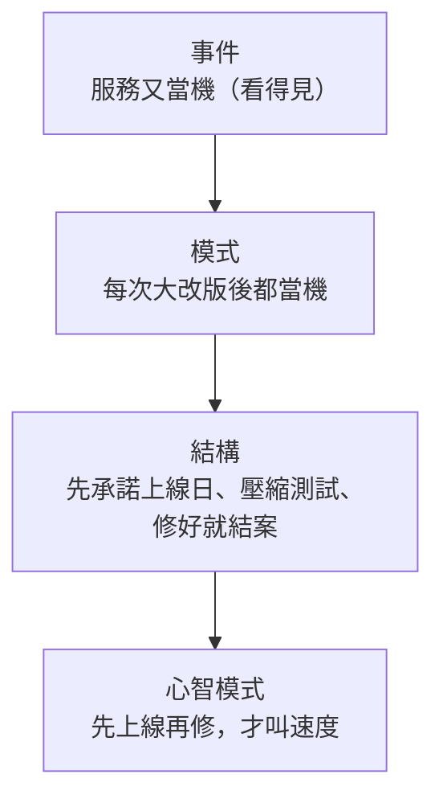

# 第 9 集｜同一種問題為什麼一再發生？冰山模型的四層

▶ [看影片](https://youtube.com/shorts/NwvAH6ELey8)　｜　[回到索引](../README.md)

## 核心觀念

同一種問題一再發生，常是因為我們一直在修「看得到的事件」，卻沒有去改**造成它的結構**，以及撐住這個結構的**想法**。冰山模型把一件事分成四層，讓你一層一層往下問。

## 重點整理

- **從哪裡來**：1990 年 Senge 提出三個看事情的層次：事件、行為模式、系統結構。1999 年 Daniel Kim 的入門小冊畫出冰山圖（圖註來源是 Innovation Associates），並往下再加心智模式與願景。**誰最先畫出冰山，Kim 的文本沒有載明。**
- **為什麼叫冰山**：我們看得到的只有冰山一角，也就是事件，所以常讓它主導決策。
- **四層**（本片用常見的四層版，省略願景）：

| 層 | 問題 | 說明 |
|---|---|---|
| 事件 | 發生了什麼？ | 看得見的一件事 |
| 模式 | 這是第幾次？有規律嗎？ | 一再發生的規律 |
| 結構 | 什麼安排讓它一再發生？ | 系統各部分的組織方式（前面第 3–7 集的環路、瓶頸，都在這一層） |
| 心智模式 | 我們信什麼，才這樣安排？ | 撐住結構的想法；Kim 稱它是結構的「藍圖」 |

- **假設例：團隊三天兩頭在救火**
  1. 事件：今晚服務又當機，全員搶修
  2. 模式：每次大改版後都當機，這季第 4 次
  3. 結構：上線日期先對客戶承諾、測試時間被壓縮、修好就結案，沒人回頭改流程
  4. 心智模式：「先上線再修，才叫速度」

- **帶走四句**：發生了什麼？這是第幾次？什麼安排讓它一再發生？我們信什麼，才這樣安排？

## 引文

> "Because we only see the tip of the iceberg, the events, we often let those drive our decision-making."
> — Daniel H. Kim，*Introduction to Systems Thinking*，Pegasus，1999

**意譯**：因為我們只看得到冰山一角，也就是事件，所以常常讓它主導我們的決策。

> "Our ability to influence the future increases as we move from the level of events to that of vision."
> — 同上

**意譯**：從事件的層次一路走向願景的層次，我們影響未來的能力就越大。

> "view reality at three distinct levels: events, patterns of behavior, and systemic structure"
> — Peter Senge，"The Leader's New Work: Building Learning Organizations"，*MIT Sloan Management Review*，Fall 1990（片段）

**意譯**：從三個不同的層次來看現實：事件、行為模式、系統結構。（文中沒有「冰山」一詞，只有三層次的說法。）

## 推導與備註

- **救火團隊是我們的假設例，不是真實個案；例子中的結構與心智模式，是我們的推演，不是 Senge 或 Kim 的原話。**
- Kim 說心智模式是結構的「藍圖」；「想法沒變，新結構也容易變回去」是我們的**推導**。
- 冰山常見有三層、四層、五層的版本，本片取四層。
- 常見歸屬（Senge 1990／1999、Meadows 2008 等）只是引用慣例，我們沒查到冰山圖最初的出處，不下定論。

## 來源

- Peter Senge, "The Leader's New Work," *MIT Sloan Management Review*, Fall 1990
- Daniel H. Kim, *Introduction to Systems Thinking*, Pegasus, 1999（pp.4–5「Putting Systems in Context: The Iceberg」；pp.17–18 觀點層次與行動模式）

（完整資訊見 [references.md](../references.md)）
