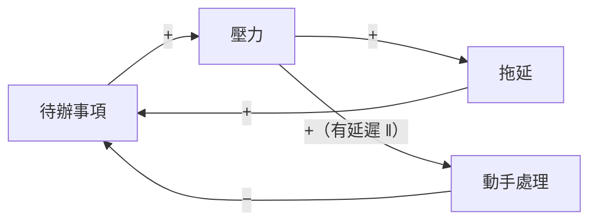

# 第 10 集｜想把問題畫出來，從哪裡下筆？因果環路圖

▶ [看影片](https://youtube.com/shorts/SXmsCWxv52U)　｜　[回到索引](../README.md)

## 核心觀念

因果環路圖（causal loop diagram）用「名詞＋箭頭」，把「誰影響誰」畫出來。畫完之後，**沿著箭頭走一圈**，就能判斷這一圈是增強環路（R）還是調節環路（B），並藉此讀出問題的走勢、預警還沒發生的問題。

## 重點整理

- **從哪裡來**：脫胎自系統動力學。Forrester 1971 年寫道，社會系統屬於多環路、非線性的回饋系統；Kim 說，系統思考領域把這種回饋環路圖稱為 causal loop diagram。最早是誰畫出來的，不同文獻說法不一，本片不下定論。
- **怎麼畫**（假設例：待辦清單）
  1. **選變數**：選能隨時間變多、變少的名詞（待辦事項、壓力、拖延）。
  2. **連箭頭、標 + 或 −**：「＋」是同向（一起增減）；「−」是反向（一增一減）。
  3. **沿箭頭走一圈**：從「待辦事項 ↑」出發，回來還是 ↑ → 變化愈推愈大 → **增強環路 R**（滾雪球，往上、往下都有可能；第 6 集的富者愈富就是一例）。
  4. **換一圈再走**：從「壓力 ↑」走過「動手處理」，回來變成 ↓ → 變化被抵消 → **調節環路 B**（像恆溫器，把系統拉回目標）。見效要等一陣子的連結，標上延遲 ‖。

- 圖中：待辦事項 → 壓力 → 拖延 → 待辦事項，**3 個「＋」＝ R**（越拖越多）；待辦事項 → 壓力 → 動手處理 → 待辦事項，有 1 個「−」＝ **B**（處理見效慢，所以有延遲）。
- **為什麼數「−」行得通**（**推導**）：每個「−」會讓方向翻轉一次。走一圈翻轉**偶數次**（0 次也算）會翻回原方向，變化被放大 → R；翻轉**奇數次**，回來是反方向，變化被抵消 → B。例：2 個「−」，↑ → ↓ → ↑，回到原方向。
- **畫完先讀圖**：
  - 急速上升或下降 → 通常是 R 在推
  - 來回擺盪 → 通常是 B 在拉
  - R 往壞的方向轉 → 惡性循環，要找出怎麼打斷
- **提早預警**：
  - 圖上有 B 又有延遲 ‖ → 預期像鐘擺的擺盪。
  - 圖上只有 R 在長、看不到 B → 問：成長造成什麼壓力？哪裡有容量限制或瓶頸？（第 7 集）
- **帶走四句**：哪些名詞能變多、變少？誰影響誰？走一圈翻幾次，是 R 還是 B？有沒有 ‖？只有 R、沒有 B 嗎？

## 引文

> "Social systems belong to the class called multi-loop nonlinear feedback systems."
> — Jay W. Forrester，"Counterintuitive Behavior of Social Systems"，*Technology Review*，1971 年 1 月，Section I

**意譯**：社會系統屬於多環路、非線性的回饋系統這一類。

> "…the countering actions often overshoot the goal, and the system oscillates back and forth, much like a pendulum."
> — Daniel Kim & Virginia Anderson，*Systems Archetype Basics*，1998，Section 1 "A Review of Causal Loop Diagrams"

**意譯**：反向的調整常常過頭，系統就像鐘擺一樣來回擺盪。

> "What pressures does the growth produce in the system?… What capacity limits or bottlenecks do we see?"
> — 同上，Section 4 "Limits to Success"

**意譯**：成長在系統裡造成了什麼壓力？……我們看得到哪些容量限制或瓶頸？

另外，以下是 Kim 1999 的內容，我們以**意譯**（沒有逐字引號）使用：
- 圖叫 causal loop diagram；用 s／o（相同／相反）標連結，**數 "o" 的個數**：沒有或偶數個 → reinforcing，奇數個 → balancing（腳註：經典系統動力學用 + 與 −）。
- reinforcing 是朝同方向愈變愈大（vicious cycles）；balancing 是以反方向的變化抵抗原方向的變化（例：thermostat）。
- 急速上升或下降的曲線通常表示 reinforcing；擺盪的曲線暗示 balancing。

## 推導與備註

- **待辦清單的例子是我們的假設例**，不是真實個案，也不是 Kim 或 Forrester 的案例。
- 「數 −（Kim 原文是 "o"）的個數」判斷法與「走一圈、說故事」是 Kim 1999 的方法；**「為什麼翻轉次數能判斷 R 或 B」的說明是我們的推導**，不是 Kim 的原話。
- 以 ‖ 標延遲是常見畫法；Kim 的圖用文字 "Delay" 標示，不是逐字出自上述文獻。
- 「急升急降 → R、擺盪 → B」是 Kim 的「通常／suggests」說法，不是絕對。
- 本片刻意沒有使用黃仁勳的引文：沒有恰好貼合這一集的原話。

## 來源

- Jay W. Forrester, "Counterintuitive Behavior of Social Systems," *Technology Review*, January 1971
- Daniel H. Kim & Virginia Anderson, *Systems Archetype Basics*, 1998（Section 1、Section 4）
- Daniel H. Kim, *Introduction to Systems Thinking*, 1999（"Looking for a Sign: Loops and Labels"）

（完整資訊見 [references.md](../references.md)）
