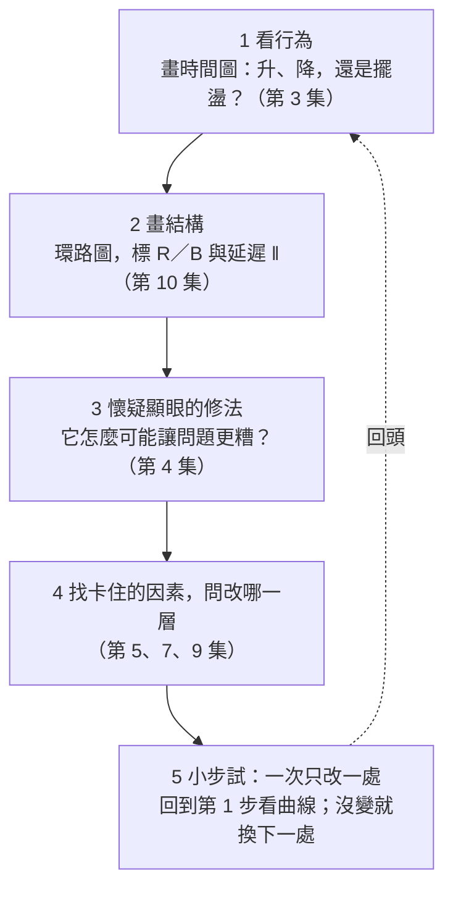

# 第 11 集｜問題那麼複雜，力要用在哪裡？槓桿點怎麼找

▶ [看影片](https://youtube.com/shorts/z0vUfHst0xU)　｜　[回到索引](../README.md)

## 核心觀念

**槓桿點**是系統裡「改一處，整體表現就跟著變」的地方。它很難找，因為直覺常把它用反、因果離得遠。沒有公式，但有方法：先看行為、畫出結構、懷疑最顯眼的修法、找出卡住的因素、再問「我改的是哪一層」，最後小步試、回頭檢查。這套方法的每一步，都來自前面幾集。

## 重點整理

- **槓桿點是什麼**：Meadows 說，是複雜系統裡的某些地方，在那裡改動一小處，就能讓一切產生大變化。
- **為什麼常常找不到**（三層原因）：
  1. 直覺常用反：大家早就在使勁推，方向卻是反的（Meadows、Forrester）。
  2. 因果離得遠：原因與結果隔著時間與空間（Senge 1990）。
  3. 眼前有效，遠處出事：所以最顯眼的修法，常常不是答案。（**這一點是我們的歸納**）
- **三種改法，各自改到什麼**（我們對 Meadows 清單的歸納；從淺到深）：

| 改什麼 | 改變了什麼 | 對應 Meadows 清單項次 |
|---|---|---|
| 數字（補貼、稅、標準等參數） | 只改多少、多快；環路還在，模式照舊 | #12 |
| 環路、資訊、規則 | 改系統怎麼運轉，模式本身跟著變 | #7 增強環路增益、#8 負回饋強度、#9 延遲長度、#6 資訊流結構、#5 規則 |
| 目標 | 改整個系統要產出什麼 | #3 |

  Meadows 對「參數」寫道，它們很少改變行為（"But they rarely change behavior."）。她的完整清單共 12 級，她自己說是「暫定的」（tentative）。

- **沒有公式，但有五步**（**推導：五步的編排與對應是我們整理的，不是任何一位作者的原創清單**）：

  - **第 1 步 看行為**：Meadows〈Dancing with Systems〉："Before you disturb the system in any way, watch how it behaves." 先看它隨時間怎麼走（升、降、擺盪）。
  - **第 2 步 畫結構**：把環路圖畫出來；Meadows 建議把模型攤出來讓人檢驗（"Get your model out there where it can be shot at."）。
  - **第 3 步 懷疑顯眼的修法**：Kim & Anderson 的問句：這個解法怎麼可能繞回來讓問題更糟？
  - **第 4 步 找卡住的因素、問改哪一層**：
    - 找限制：Kim & Anderson 說，成長受限的情況，真正的槓桿不在於更用力推成長的引擎，而在於找出並管理限制成功的因素。
    - 問四句（**問句為我們整理，對應三種改法**）：
      1. 哪一個 R 在主導？→ 降低它的增益
      2. B 夠不夠強、夠不夠快？→ 補強它，或縮短延遲
      3. 資訊和規則在鼓勵什麼？→ 補資訊、改規則
      4. 所有人在追的目標是什麼？→ 改目標
  - **第 5 步 小步試**：Meadows〈Dancing with Systems〉："What's appropriate when you're learning is small steps, constant monitoring, and a willingness to change course as you find out more about where it's leading." 一次只改一處，試一段時間，再回到第 1 步看行為有沒有變；沒變就換下一處。
- **為什麼現在更需要**：agent 做事快，方向偏了也偏得快，所以更要先找對地方。（**推導**）
- **前面每一集，都是一個工具**（各集與五步的對應是我們整理的）：第 3 集延遲（看行為）、第 4–7 集環路與基模（懷疑修法、找限制）、第 9 集冰山（問改哪一層）、第 10 集環路圖（畫結構）。
- **帶走四句**：
  1. 行為：它隨時間怎麼走？
  2. 結構：哪些環路與延遲造成它？
  3. 改法：我改的是數字、結構，還是目標？
  4. 驗證：怎麼小步試、再看曲線？

## 引文

> "…places within a complex system… where a small shift in one thing can produce big changes in everything."
> — Donella H. Meadows，〈Leverage Points: Places to Intervene in a System〉，Sustainability Institute，1999，p.1（片段）

**意譯**：複雜系統裡的某些地方，在那裡改動一小處，就能讓一切產生大的變化。

> "The systems analysts I know have come up with no quick or easy formulas for finding leverage points."
> — 同上，p.2（影片畫面為縮短版："…no quick or easy formulas for finding leverage points."）

**意譯**：我認識的系統分析師，都沒有想出什麼快速又簡單的公式來找槓桿點。

> "…we intuitively use them backward, systematically worsening whatever problems we are trying to solve."
> — 同上，p.2（片段）

**意譯**：（槓桿點）我們憑直覺會用反，系統性地讓我們想解決的問題更糟。

> "…the better you are at systems thinking so that you could orchestrate millions of agents solving problems autonomously, the better off you are."
> — 黃仁勳，Y Combinator Startup School 2026，43:23（YouTube 自動字幕；影片畫面中間略有刪節）

**意譯**：你越擅長系統思考，就越能指揮數百萬個自主解題的 agent，你就越有優勢。

另外以下是原文片段（意譯在後）：

> "Dynamic complexity arises when cause and effect are distant in time and space…"
> — Peter Senge，"The Leader's New Work"，*MIT Sloan Management Review*，Fall 1990，"Distinguishing Detail Complexity from Dynamic Complexity"

**意譯**：當因與果在時間與空間上相隔遙遠時，就產生了動態複雜性。

> "The real leverage in a 'Limits to Success' situation does not lie in pushing harder on the engine of growth, but in finding and managing the factor or factors that are limiting success…"
> — Daniel Kim & Virginia Anderson，*Systems Archetype Basics*，1998，Limits to Success 一章，pp.51–52

**意譯**：在「成長上限」的情境裡，真正的槓桿，不在於更用力推成長的引擎，而在於找出並管理那些限制成功的因素。

## 推導與備註

- **五步程序的編排、各步對應到第幾集、四個提問與 Meadows 項次的對應、三種改法的歸納、「agent 偏了也偏得快」，都是我們的推導或對照**，不是 Meadows、Kim、Senge 或黃仁勳的說法。
- Meadows 稱她的清單是暫定的；五步不是任何一位作者的原創清單。
- 〈Dancing with Systems〉是網頁文章，沒有頁碼；我們逐字複核過網頁版。
- **刻意沒用**：Senge《第五項修練》的十一條定律（例如 "The easy way out usually leads back in"）。我們手上沒有可靠的書籍原文（只有二手網站轉載），沒逐字查證，所以不引用定律原句。
- 本頻道與 Meadows、Kim、Senge、黃仁勳及相關出版社、公司沒有關聯。

## 來源

- Donella H. Meadows, "Leverage Points: Places to Intervene in a System," 1999（pp.1–2；pp.5–15 參數、資訊、規則、目標；p.3 清單項次）
- Donella H. Meadows, "Dancing with Systems"
- Peter Senge, "The Leader's New Work," *MIT Sloan Management Review*, 1990
- Daniel H. Kim & Virginia Anderson, *Systems Archetype Basics*, 1998（Fixes That Fail、Limits to Success）
- Y Combinator, Jensen Huang, Startup School 2026

（完整資訊見 [references.md](../references.md)）
